<p align="center">
  
</p>

<h1 align="center">MiVibra TV</h1>

<p align="center">
  <b>Toda tu televisión, tus películas y tus videos en una sola app.</b><br>
  Reproductor para <b>Android TV, celular y tablet</b> con interfaz de vidrio, hecho en Colombia por MiVibra.
</p>

<p align="center">
  <a href="https://github.com/simank19/mivibra-tv/releases/latest"><b>⬇ Android (APK)</b></a>
  &nbsp;·&nbsp;
  <a href="https://github.com/simank19/mivibra-tv/releases/latest"><b>💻 PC Windows (.exe)</b></a>
  &nbsp;·&nbsp;
  <a href="https://simank19.github.io/mivibra-tv/panel/"><b>📺 Agregar mi lista a la TV (panel web)</b></a>
</p>

<p align="center">
  
</p>

---

## ¿Qué es?

MiVibra TV junta en un solo lugar las listas que ya tienes (M3U, Xtream Codes, Portal y MAC), tu propio servidor de películas (Jellyfin, Emby o Plex), tus páginas de videos, canales gratuitos y legales, YouTube, Twitch, Kick, radio, música y juegos clásicos. Todo se organiza solo: sin repetidos, con la mejor calidad, por géneros, año y estrenos, con fichas, carátulas y perfiles para toda la familia.

> MiVibra TV **no incluye ni vende contenido**. Reproduce las fuentes que agrega cada usuario y canales públicos gratuitos.

## Cómo se ve

| Televisor | |
|---|---|
|  |  |
| **Películas:** estrenos primero, filtros por categoría, género y orden | **Ficha automática:** sinopsis, reparto, géneros y audio/subtítulos |
|  |  |
| **En vivo:** secciones, países, categorías y guía | **Buscar:** teclado QWERTY para el control remoto, actores y cartelera |
|  |  |
| **Perfiles** con avatares 3D y PIN | **Perfil infantil** con tiempo límite y YouTube para niños |
| 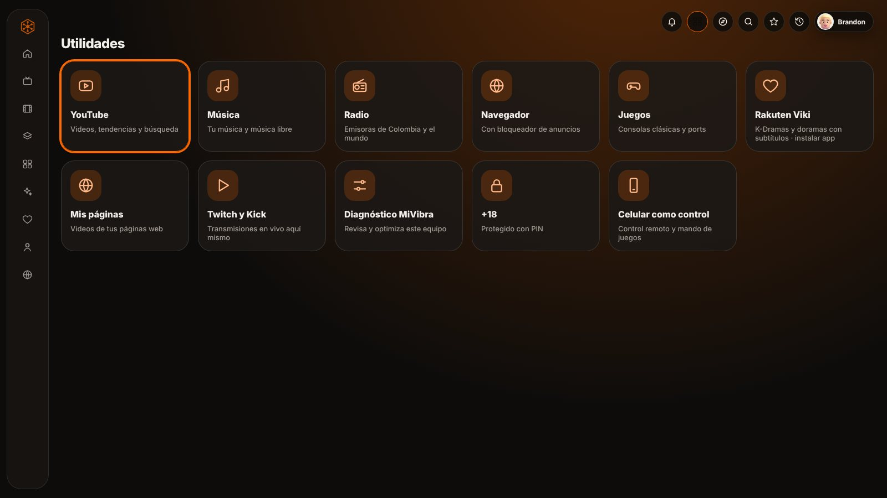 | 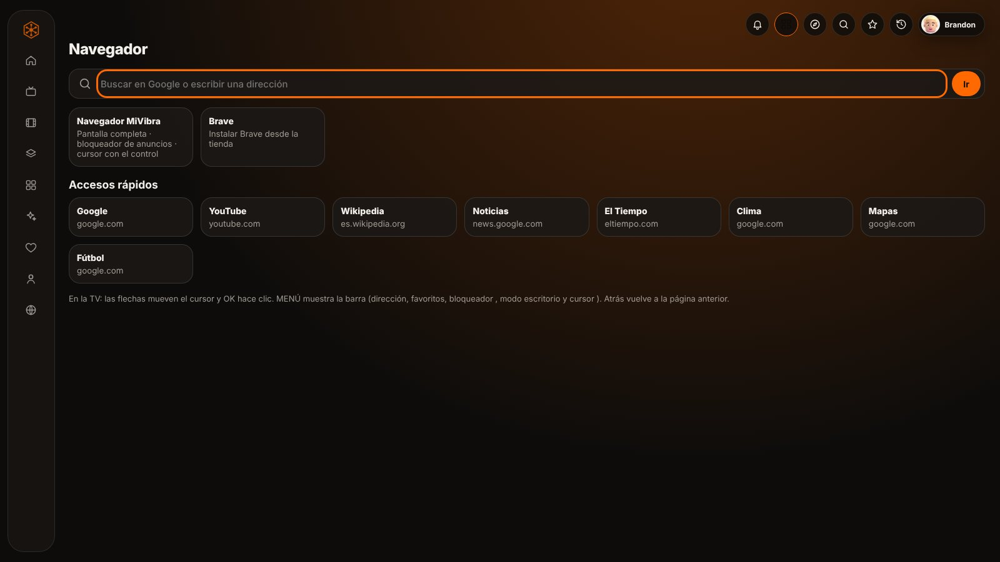 |
| **Utilidades:** YouTube, música, radio, navegador, juegos, Twitch y Kick, Mis páginas, diagnóstico, +18 y celular como control | **Navegador** con bloqueador de anuncios, cursor con el control y accesos rápidos |
| 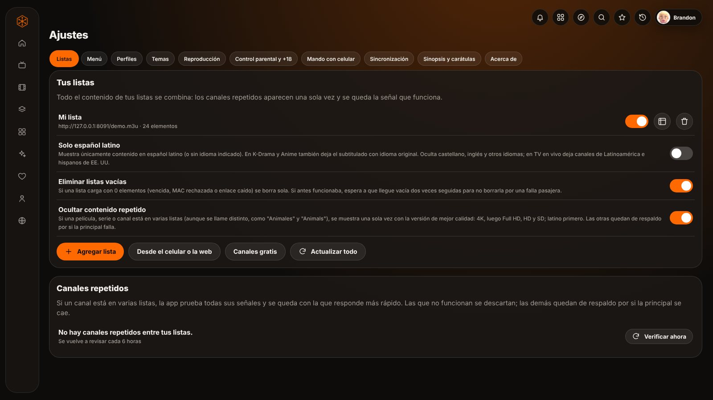 | 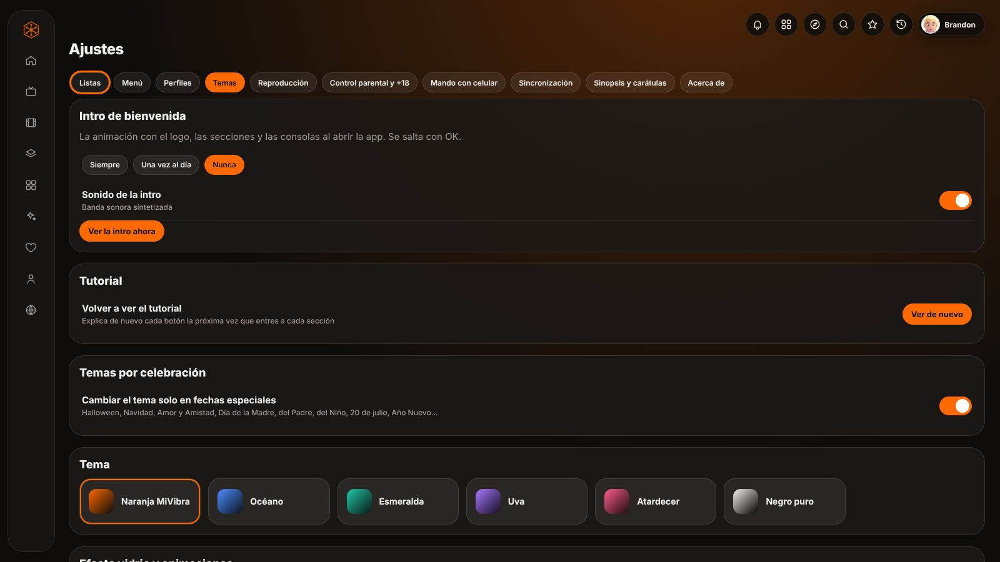 |
| **Ajustes › Listas:** activar, guía EPG, borrar, sin repetidos, solo latino y agregar desde el celular o la web | **Ajustes › Temas:** intro de bienvenida, tutorial, temas por celebración y colores |
| 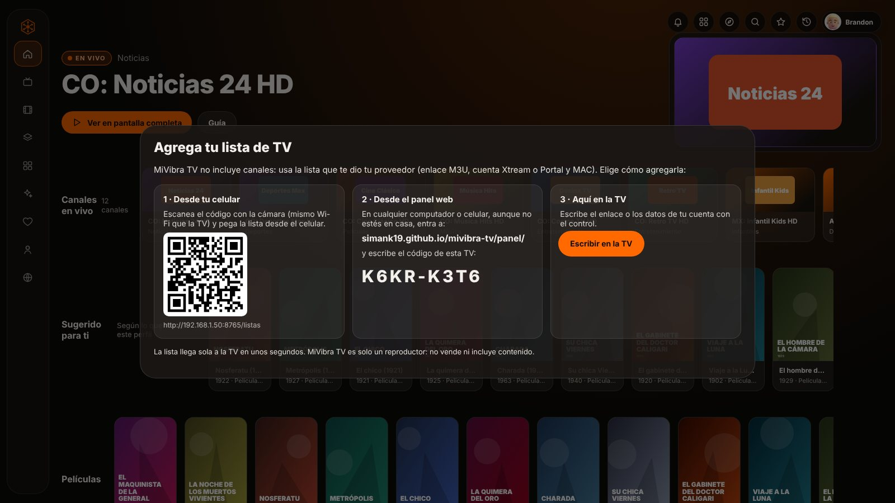 | 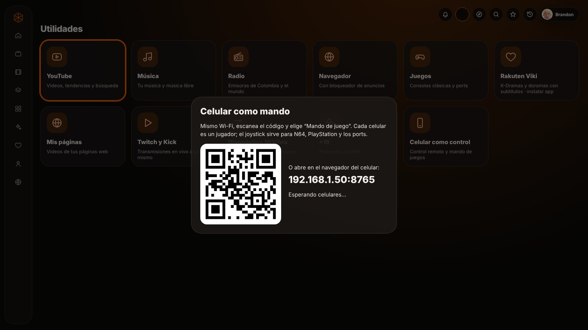 |
| **Agrega tu lista:** con el QR desde el celular, desde el panel web con el código de la TV o con el control | **Celular como mando:** escanea el código y úsalo como control remoto o mando de juego (jugador 1 y 2) |

**Juegos estilo consola**

| | |
|---|---|
| 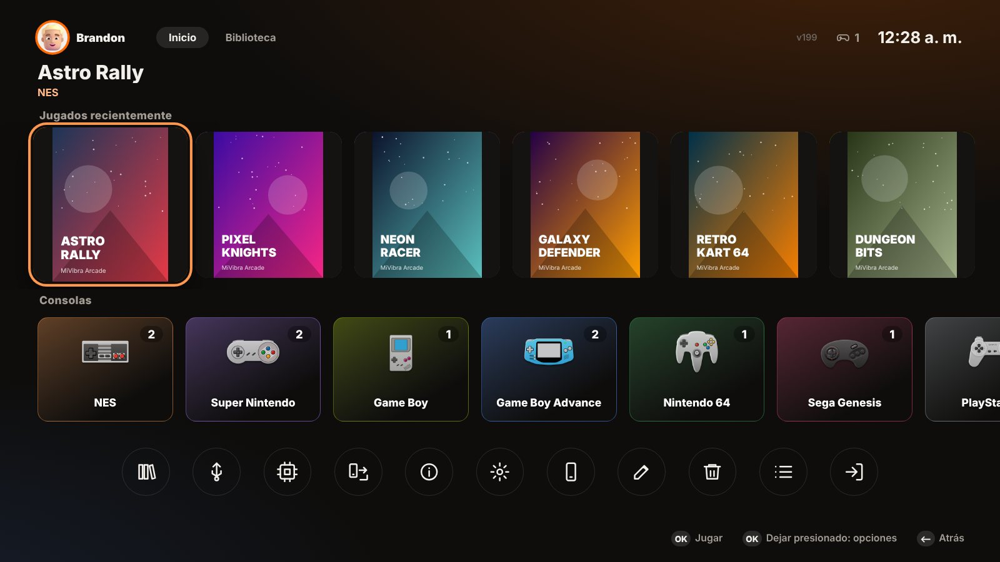 | 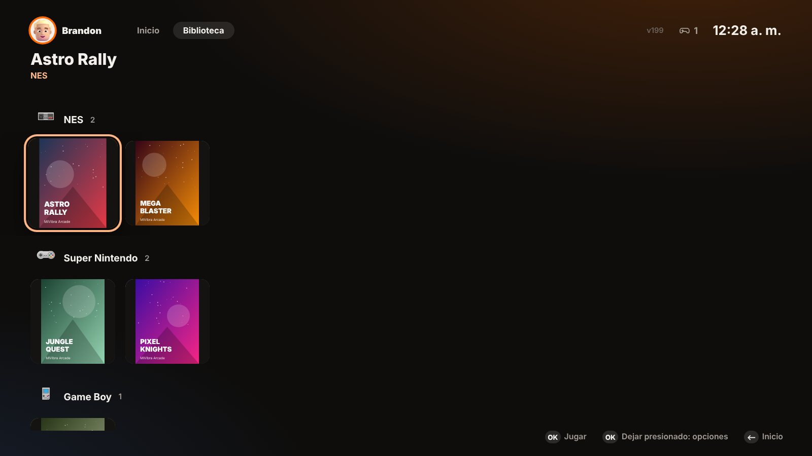 |
| **Inicio:** jugados recientemente con carátula, consolas con su ícono y botones de buscar, BIOS, enviar, información, emuladores, editar y borrar | **Biblioteca:** todos tus juegos en estantes por consola |
| 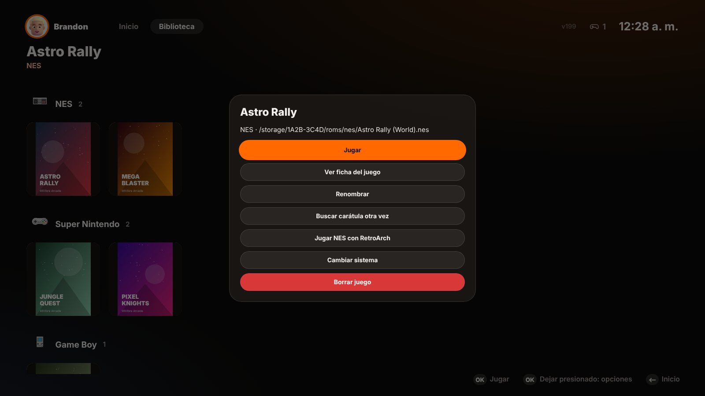 | 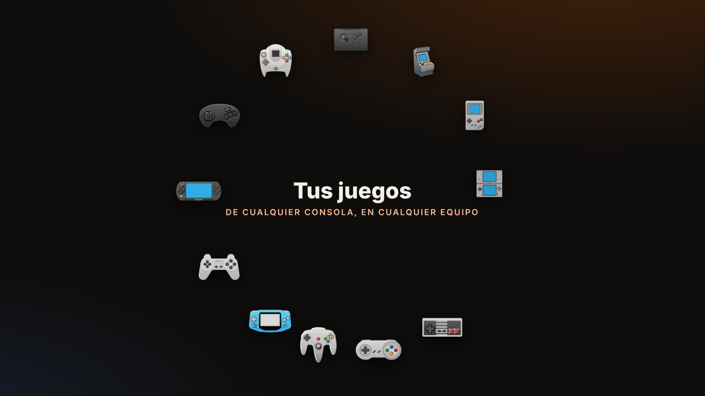 |
| **Opciones de cada juego** (dejar presionado OK o el lápiz): ficha, renombrar, carátula, emulador y sistema | **Intro de bienvenida** con las secciones de la app y las consolas |

| Celular | | |
|---|---|---|
|  |  |  |
| 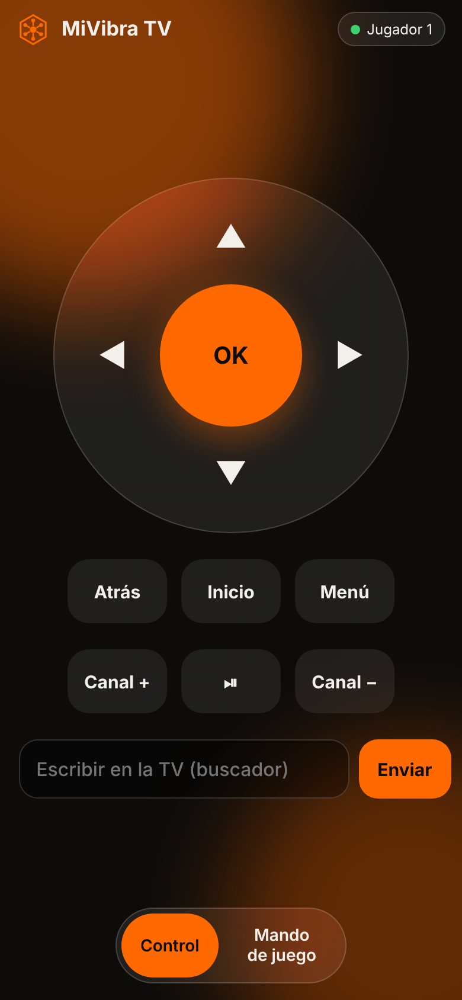 | 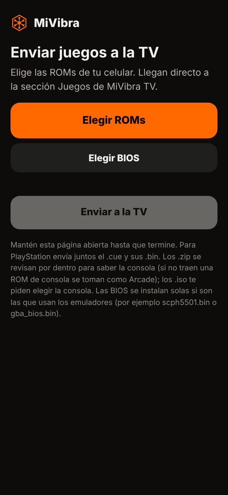 | 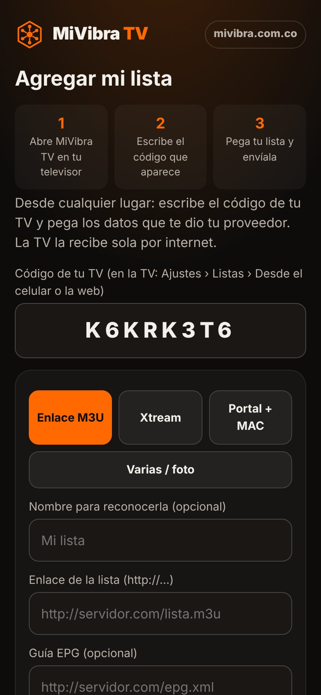 |
| **Control remoto y mando** | **Enviar juegos y BIOS** a la TV | **Panel web:** agrega tu lista con el código de la TV |

<sub>Las carátulas y títulos de las capturas son de ejemplo: clásicos de dominio público, canales y juegos inventados.</sub>

## Tu lista, tu TV

Cada usuario monta **su propia lista** y, si tiene un servicio con MiVibra, la suma a las **listas incluidas** que le envía el administrador. Hay tres formas de agregarla:

| Desde la TV | Desde el celular | Desde el panel web |
|---|---|---|
| Ajustes › Listas › **Agregar lista**, con el control remoto. | Escanea el **código QR** de la TV (mismo Wi-Fi), pega la lista o **envía una foto** de ella. | Desde cualquier lugar: entra a **[simank19.github.io/mivibra-tv/panel](https://simank19.github.io/mivibra-tv/panel/)**, escribe el **código de 8 letras** de tu TV y pega la lista. Llega sola por internet. |

- Acepta **enlace M3U**, **Xtream Codes**, **Portal y MAC**, Jellyfin/Emby, Plex, archivo, **varias a la vez** (`.txt` o texto copiado de WhatsApp/correo) y **desde imagen**: la app lee los enlaces, usuarios y MAC de una foto o captura (sin internet).
- **Mis listas:** seleccionar varias, activar/desactivar, guía EPG por lista y borrar. Las listas incluidas no se pueden borrar desde la TV del cliente.
- Las listas propias viajan con la cuenta de Google del usuario a sus otras TV.
- El panel no guarda nada: la TV recibe la lista y la borra del buzón al instante.

## Funciones

### Fuentes de contenido
- **Listas M3U/M3U8** por enlace, archivo, varias a la vez desde un `.txt`, texto pegado o **una foto de la lista**.
- **Xtream Codes** (en vivo, películas y series con temporadas).
- **Portal y MAC** (Stalker/Ministra): una o varias MAC; se pueden pegar desde WhatsApp o subir en `.txt`.
- **Tu servidor propio:** Jellyfin, Emby o Plex, con el idioma real de cada pista de audio y subtítulos.
- **Tus páginas web:** busca los videos de tu página (MP4, YouTube, Vimeo, Drive o cualquier reproductor incrustado), toma sus categorías, arma series "En emisión" y se actualiza cada hora.
- **Canales gratuitos y legales** con un toque, y cine clásico de dominio público.

### Orden inteligente
- **Sin repetidos:** si un título está en varias listas (aunque se llame distinto, como "Animales" y "Animals"), aparece una vez con la **mejor calidad** (4K solo en pantallas 4K, luego Full HD, HD, SD). Las demás quedan de respaldo.
- **Solo español latino** (opcional), con subtitulado en K-Drama y Anime.
- **Estrenos primero**, filas por año, ganadoras del Óscar por categoría y géneros según TMDB.
- **Anime en emisión** (MyAnimeList), K-Drama, Infantil, Documentales, Western y Plataformas.
- **Búsqueda inteligente:** por título, por **actor o director**, y filtros **En cartelera** y **Próximos estrenos** en Colombia.
- Listas vacías o caídas se eliminan solas; se pueden seleccionar varias y borrarlas juntas.

### Reproductor
- Nativo (Media3/ExoPlayer): HLS, DASH, MPEG-TS, MP4 y MKV, con audio AC3/E-AC3/DTS.
- **Arranque directo:** antes de abrir elige la versión que responde y aprende qué servidores fallan.
- Controles abajo que se esconden solos, +1:30 para saltar la intro, silencio, favorito y lista de canales con países y deportes.
- **Audio y subtítulos:** muestra solo los idiomas que trae cada contenido; búsqueda de subtítulos en internet.
- Siguiente capítulo automático, continuar donde lo dejaste y **ventana flotante** (PiP).
- **Continuar viendo** y recomendaciones en el inicio de Android TV.

### También incluye
- **YouTube y YouTube Music** dentro de la app, **Twitch y Kick** con canales en vivo, radio, música y **Rakuten Viki**.
- **Navegador** con teclado propio para el control remoto y **búsqueda por voz** (también con el botón de micrófono del control).
- **Perfiles** con avatares 3D de Fluent Emoji, PIN y temas por celebración (Halloween, Navidad, Amor y Amistad…).
- **Perfil infantil:** solo contenido para niños según TMDB, tiempo límite diario y **YouTube para niños** (búsqueda estricta y solo videos "hechos para niños").
- **+18** oculto en Utilidades, con PIN, fuera del inicio y del historial.
- **Superadministrador:** listas, claves y orden del menú se comparten con todos los usuarios de la cuenta.
- **Intro de bienvenida** con las secciones de la app y banda sonora (siempre, una vez al día o nunca).
- **Tutorial guiado** de una sola vez por sección, con las novedades marcadas.
- Actualizaciones automáticas con una **campana** en la barra de arriba.

### Juegos estilo consola
- **Pantalla tipo consola**: jugados recientemente, tus **consolas con su ícono** y una **biblioteca por estantes**.
- NES, SNES, Game Boy/Color/Advance, N64, Nintendo DS, PlayStation, **PSP**, Dreamcast y GameCube (con RetroArch), Sega Genesis, Master System, Game Gear, Atari, PC Engine, Neo Geo Pocket, WonderSwan, **Neo Geo** (romsets y `.neo`) y arcade; ports como Doom, Quake, Wolfenstein 3D y Cave Story.
- ROMs desde la memoria, **cualquier USB o carpeta** (explorador propio) o **enviadas desde el celular** por Wi-Fi. Abre **zip, 7z y rar**, incluso rar en partes y archivos dentro de otros.
- **Carátulas y nombres automáticos** (libretro-thumbnails), **ficha del juego** (Wikipedia/Wikidata) con vista previa al pasar encima, **renombrar** y **buscar otra carátula**.
- **Marcos de pantalla** (bezels) por consola, con varios estilos.
- **Mandos**: cualquier control USB/Bluetooth (con asistente para configurarlo y probarlo) y **uno o dos celulares como control** (jugador 1 y 2).
- Emulador propio de MiVibra, **RetroArch** o **PPSSPP** para PSP, a elección por consola; importación de BIOS para todos.
- **Editar juegos** (lápiz) y **Borrar juegos** (papelera); dejar presionado OK abre las opciones de un juego.

## Instalar

**Android (TV, celular y tablet)**
1. Descarga `MiVibraTV-N.apk` desde **[Releases](https://github.com/simank19/mivibra-tv/releases/latest)**.
2. Ábrela en el celular, la tablet o la TV (en TV puedes usar Downloader o una USB) y acepta "Instalar apps de origen desconocido".
3. Las versiones nuevas se instalan encima sin perder tus datos; la app avisa sola con la campana.

**PC con Windows 10 u 11**
1. Descarga `MiVibraTV-PC-N.exe` desde **[Releases](https://github.com/simank19/mivibra-tv/releases/latest)** y ábrelo. Si Windows muestra "Windows protegió su PC", toca **Más información › Ejecutar de todas formas** (el instalador no tiene firma digital de pago).
2. Se instala solo, sin pedir permisos de administrador, y crea el acceso directo **MiVibra TV** en el escritorio.
3. Cada versión nueva sale con el mismo número que la de Android: la campana la descarga e instala sola y la app se vuelve a abrir.

En el PC: **Esc** o el botón Atrás del mouse = Atrás, **F11** = pantalla completa, flechas y Enter para moverte como con el control. En el reproductor: Espacio pausa, ← → adelantan o retroceden (en vivo abren la lista de canales), ▲ ▼ cambian de canal y **L** abre la lista. Los juegos usan EmulatorJS (incluido en el instalador, funciona sin internet) con el teclado, cualquier mando USB/Bluetooth o el celular como control; Dreamcast y GameCube se abren con RetroArch para Windows.

## Configuración opcional

| Para | Dónde se consigue (gratis) | Dónde va en la app |
|---|---|---|
| Sinopsis y carátulas | Clave de API en themoviedb.org | Ajustes › Sinopsis y carátulas |
| YouTube dentro de la app | YouTube Data API v3 en Google Cloud | Ajustes › Sinopsis y carátulas |
| Subtítulos de internet | Clave en subdl.com | Ajustes › Sinopsis y carátulas |
| Canales en vivo de Twitch y Kick | dev.twitch.tv y kick.com › Developer | Ajustes › Sinopsis y carátulas |
| Sincronización, cuentas y panel web | Proyecto de Firebase | Ver [docs/CUENTA-GOOGLE.md](docs/CUENTA-GOOGLE.md) |
| Botón de WhatsApp en el panel | Tu número (con 57) | Secreto `MV_WHATSAPP` del repositorio |

Las reglas de Firestore (superadministrador, usuarios, sincronización y buzón del panel web) están en **[firestore.rules](firestore.rules)**: cambia el correo del superadministrador y pégalas en Firebase › Firestore › Reglas.

El panel web se publica solo en GitHub Pages (`.github/workflows/panel.yml`) cada vez que cambia `listas.html`.

## Estructura del código

```
desktop/                           Versión para PC (Electron)
  main.js          Ventanas, puente con la interfaz (window.Android), juegos y actualizaciones
  lib/             Red, servidor local, EPG, Portal MAC, archivos y comprimidos (7-Zip), celular como mando
  web/player.*     Reproductor (hls.js, mpegts.js) · web/game.html  Juegos (EmulatorJS)
  scripts/fetch-ejs.js   Descarga EmulatorJS y los núcleos para el instalador
```


```
app/src/main/java/co/mivibra/tv/   Código nativo (Kotlin)
  MainActivity.kt    Interfaz web + puente nativo + ventana flotante
  Bridge.kt          Red, archivos, juegos, mando, portapapeles
  PlayerActivity.kt  Reproductor Media3 con controles propios
  ChannelPanel.kt    Lista de canales dentro del reproductor
  Stalker.kt         Enlaces de Portal y MAC
  WatchNext.kt, HomeChannel.kt   Inicio de Android TV
  GameActivity.kt    Emulador, mandos, marcos de pantalla
  RemoteServer.kt    Celular como mando, envío de ROMs y listas
  Archives.kt, NeoGeo.kt, RetroArch.kt, Overlays.kt, Ocr.kt
  Epg.kt, Storage.kt, Net.kt
app/src/main/assets/www/           Interfaz (HTML, CSS, JS)
  core.js      Navegación con control remoto, modales, red
  catalog.js   Listas, combinación sin repetidos, fichas TMDB/Jikan
  ui.js        Pantallas, búsqueda, tutorial, utilidades
  account.js   Superadministrador y listas incluidas
  mylists.js   Listas de cada usuario: celular, panel web e importar
  console.js   Juegos estilo consola · covers.js, gameinfo.js, sysicons.js
  intro.js     Intro de bienvenida
  listas.html  Página para agregar listas (celular y panel web)
  data.js      Géneros, países, idiomas, íconos, avatares
```

Cada cambio que se sube a GitHub se compila solo (GitHub Actions) y se publica en Releases.

## Créditos y licencias

- Código de MiVibra TV: **GPL-3.0** (requerida por LibretroDroid). Ver `LICENSE`.
- Reproductor: AndroidX Media3 (Apache 2.0) · Emulación: LibretroDroid y núcleos libretro (algunos solo para uso no comercial).
- Íconos de consolas: [KyleBing/retro-game-console-icons](https://github.com/KyleBing/retro-game-console-icons) (CC BY 4.0) · Marcos: libretro overlay-borders (MIT) · Carátulas: libretro-thumbnails · Fichas de juegos: Wikipedia y Wikidata.
- Archivos comprimidos: Apache Commons Compress, XZ for Java y junrar · Lectura de imágenes: Google ML Kit.
- Versión para PC: Electron (MIT), hls.js (Apache 2.0), mpegts.js (Apache 2.0), EmulatorJS (GPL-3.0), 7-Zip (LGPL, con restricción unRAR), Tesseract.js (Apache 2.0).
- Avatares: Microsoft Fluent Emoji (MIT) · Fichas: TMDB y MyAnimeList (Jikan) · Canales gratis: Free-TV/IPTV e iptv-org · Cine clásico: Internet Archive.
- Este producto usa la API de TMDB pero no está respaldado ni certificado por TMDB.

## Aviso

MiVibra TV no incluye, aloja ni vende contenido. Cada usuario es responsable de las fuentes que agrega y de tener los derechos para verlas. Los juegos y BIOS los aporta el usuario. No usa logotipos de marcas de terceros.
