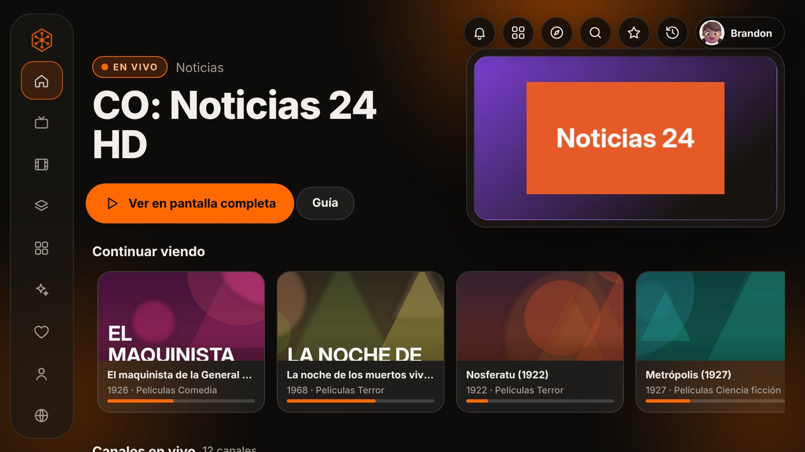
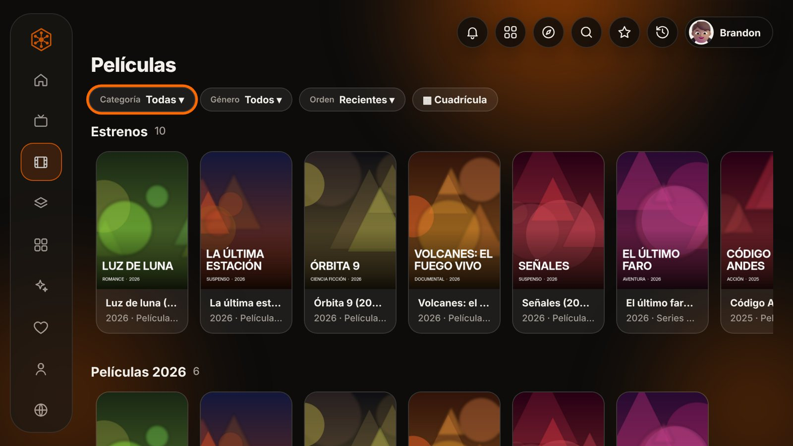
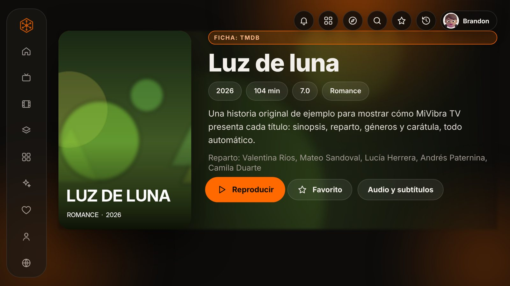
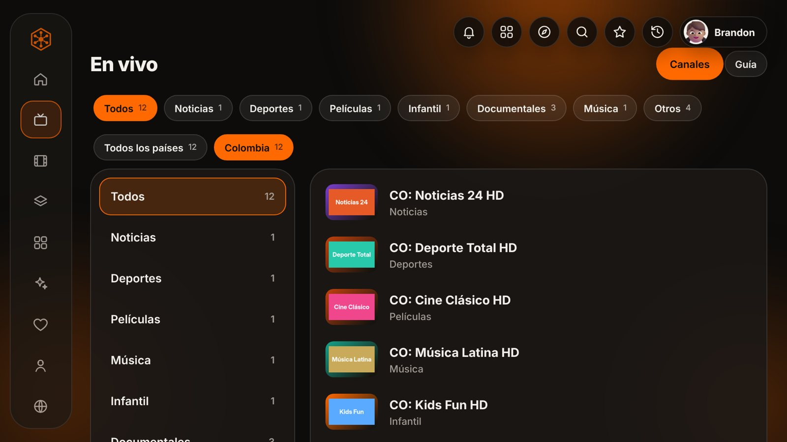
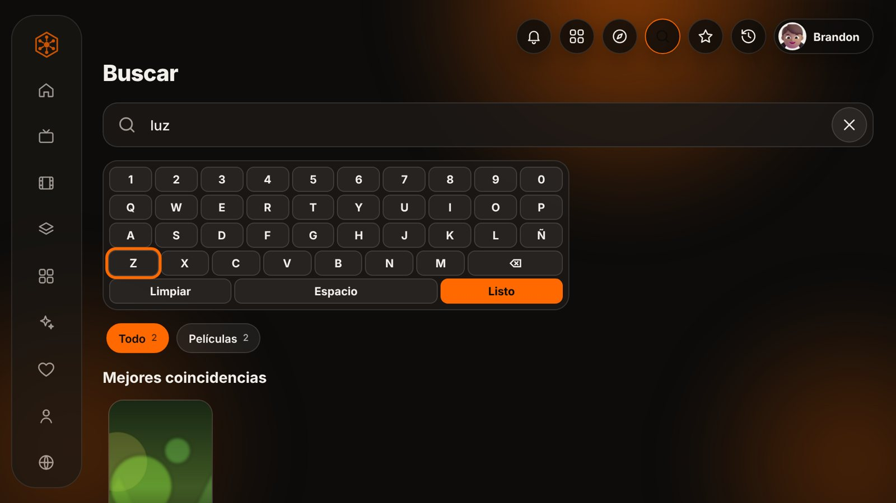
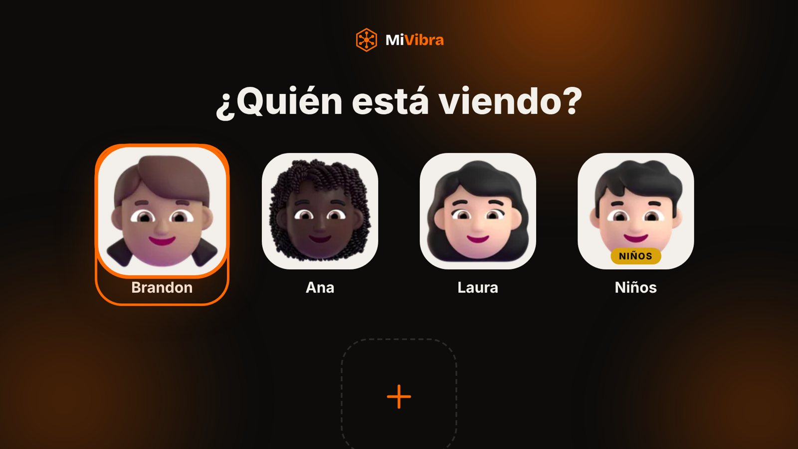
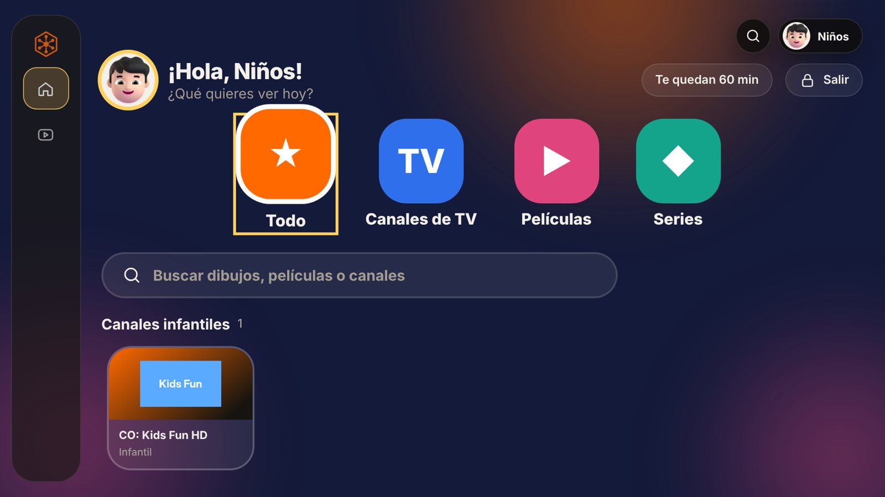
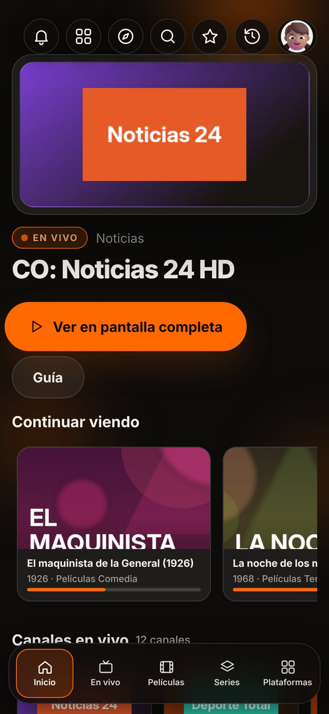
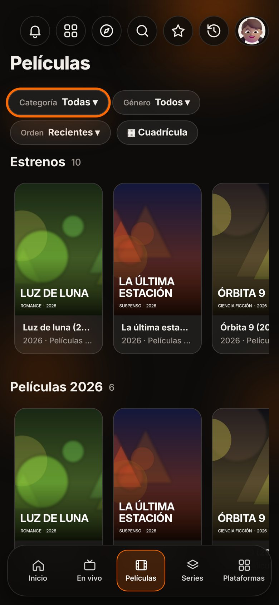
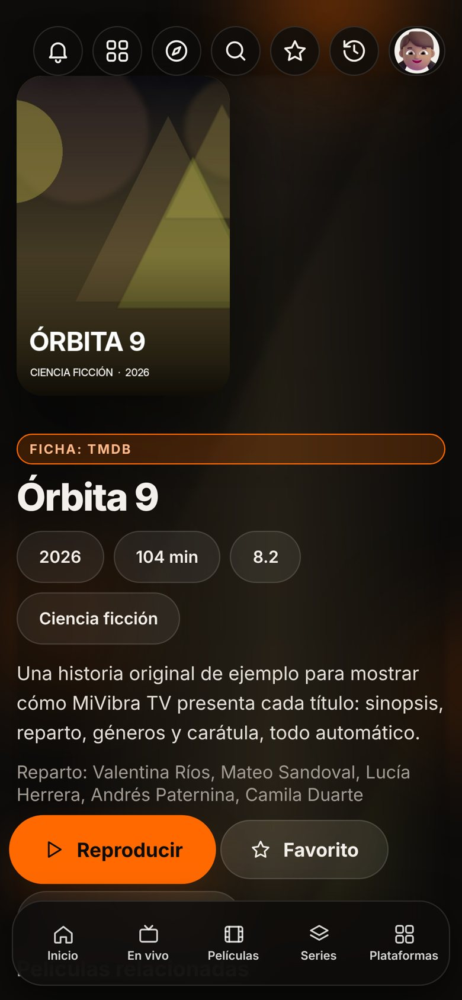

<p align="center">
  
</p>

<h1 align="center">MiVibra TV</h1>

<p align="center">
  <b>Toda tu televisión, tus películas y tus videos en una sola app.</b><br>
  Reproductor para <b>Android TV, celular y tablet</b> con interfaz de vidrio, hecho en Colombia por MiVibra.
</p>

<p align="center">
  <a href="https://github.com/simank19/mivibra-tv/releases/latest"><b>⬇ Descargar la última versión (APK)</b></a>
</p>

<p align="center">
  
</p>

---

## ¿Qué es?

MiVibra TV junta en un solo lugar las listas que ya tienes (M3U, Xtream Codes, Portal y MAC), tu propio servidor de películas (Jellyfin, Emby o Plex), tus páginas de videos, canales gratuitos y legales, YouTube, Twitch, Kick, radio, música y juegos clásicos. Todo se organiza solo: sin repetidos, con la mejor calidad, por géneros, año y estrenos, con fichas, carátulas y perfiles para toda la familia.

> MiVibra TV **no incluye ni vende contenido**. Reproduce las fuentes que agrega cada usuario y canales públicos gratuitos.

## Cómo se ve

| Televisor | |
|---|---|
|  |  |
| **Películas:** estrenos primero, filtros por categoría, género y orden | **Ficha automática:** sinopsis, reparto, géneros y audio/subtítulos |
|  |  |
| **En vivo:** secciones, países, categorías y guía | **Buscar:** teclado QWERTY para el control remoto, actores y cartelera |
|  |  |
| **Perfiles** con avatares 3D y PIN | **Perfil infantil** con tiempo límite y YouTube para niños |

| Celular | | |
|---|---|---|
|  |  |  |

<sub>Las carátulas y títulos de las capturas son de ejemplo (clásicos de dominio público y títulos inventados).</sub>

## Funciones

### Fuentes de contenido
- **Listas M3U/M3U8** por enlace, archivo o varias a la vez desde un `.txt`.
- **Xtream Codes** (en vivo, películas y series con temporadas).
- **Portal y MAC** (Stalker/Ministra): una o varias MAC; se pueden pegar desde WhatsApp o subir en `.txt`.
- **Tu servidor propio:** Jellyfin, Emby o Plex, con el idioma real de cada pista de audio y subtítulos.
- **Tus páginas web:** busca los videos de tu página (MP4, YouTube, Vimeo, Drive o cualquier reproductor incrustado), toma sus categorías, arma series "En emisión" y se actualiza cada hora.
- **Canales gratuitos y legales** con un toque, y cine clásico de dominio público.

### Orden inteligente
- **Sin repetidos:** si un título está en varias listas (aunque se llame distinto, como "Animales" y "Animals"), aparece una vez con la **mejor calidad** (4K solo en pantallas 4K, luego Full HD, HD, SD). Las demás quedan de respaldo.
- **Solo español latino** (opcional), con subtitulado en K-Drama y Anime.
- **Estrenos primero**, filas por año, ganadoras del Óscar por categoría y géneros según TMDB.
- **Anime en emisión** (MyAnimeList), K-Drama, Infantil, Documentales, Western y Plataformas.
- **Búsqueda inteligente:** por título, por **actor o director**, y filtros **En cartelera** y **Próximos estrenos** en Colombia.
- Listas vacías o caídas se eliminan solas; se pueden seleccionar varias y borrarlas juntas.

### Reproductor
- Nativo (Media3/ExoPlayer): HLS, DASH, MPEG-TS, MP4 y MKV, con audio AC3/E-AC3/DTS.
- **Arranque directo:** antes de abrir elige la versión que responde y aprende qué servidores fallan.
- Controles abajo que se esconden solos, +1:30 para saltar la intro, silencio, favorito y lista de canales con países y deportes.
- **Audio y subtítulos:** muestra solo los idiomas que trae cada contenido; búsqueda de subtítulos en internet.
- Siguiente capítulo automático, continuar donde lo dejaste y **ventana flotante** (PiP).
- **Continuar viendo** y recomendaciones en el inicio de Android TV.

### También incluye
- **YouTube y YouTube Music** dentro de la app, **Twitch y Kick** con canales en vivo, radio, música y **Rakuten Viki**.
- **Juegos clásicos** con emulación (NES, SNES, Game Boy, N64, PlayStation y más) y ports como Doom; el **celular sirve como control** por QR.
- **Perfiles** con avatares 3D de Fluent Emoji, PIN y temas por celebración (Halloween, Navidad, Amor y Amistad…).
- **Perfil infantil:** solo contenido para niños según TMDB, tiempo límite diario y **YouTube para niños** (búsqueda estricta y solo videos "hechos para niños").
- **+18** oculto en Utilidades, con PIN, fuera del inicio y del historial.
- **Superadministrador:** listas, claves y orden del menú se comparten con todos los usuarios de la cuenta.
- **Tutorial guiado** de una sola vez por sección, con las novedades marcadas.
- Actualizaciones automáticas con una **campana** en la barra de arriba.

## Instalar

1. Descarga `MiVibraTV-N.apk` desde **[Releases](https://github.com/simank19/mivibra-tv/releases/latest)**.
2. Ábrela en el celular, la tablet o la TV (en TV puedes usar Downloader o una USB) y acepta "Instalar apps de origen desconocido".
3. Las versiones nuevas se instalan encima sin perder tus datos; la app avisa sola con la campana.

## Configuración opcional

| Para | Dónde se consigue (gratis) | Dónde va en la app |
|---|---|---|
| Sinopsis y carátulas | Clave de API en themoviedb.org | Ajustes › Sinopsis y carátulas |
| YouTube dentro de la app | YouTube Data API v3 en Google Cloud | Ajustes › Sinopsis y carátulas |
| Subtítulos de internet | Clave en subdl.com | Ajustes › Sinopsis y carátulas |
| Canales en vivo de Twitch y Kick | dev.twitch.tv y kick.com › Developer | Ajustes › Sinopsis y carátulas |
| Sincronización y cuentas | Proyecto de Firebase | Ver [docs/CUENTA-GOOGLE.md](docs/CUENTA-GOOGLE.md) |

Reglas sugeridas de Firestore para la sincronización:

```
rules_version = '2';
service cloud.firestore {
  match /databases/{database}/documents {
    match /mivibra/{uid} {
      allow read, write: if request.auth != null && request.auth.uid == uid;
    }
  }
}
```

## Estructura del código

```
app/src/main/java/co/mivibra/tv/   Código nativo (Kotlin)
  MainActivity.kt    Interfaz web + puente nativo + ventana flotante
  Bridge.kt          Red, archivos, juegos, mando, portapapeles
  PlayerActivity.kt  Reproductor Media3 con controles propios
  ChannelPanel.kt    Lista de canales dentro del reproductor
  Stalker.kt         Enlaces de Portal y MAC
  WatchNext.kt, HomeChannel.kt   Inicio de Android TV
  GameActivity.kt, RemoteServer.kt, Epg.kt, Storage.kt, Net.kt
app/src/main/assets/www/           Interfaz (HTML, CSS, JS)
  core.js      Navegación con control remoto, modales, red
  catalog.js   Listas, combinación sin repetidos, fichas TMDB/Jikan
  ui.js        Pantallas, búsqueda, tutorial, utilidades
  data.js      Géneros, países, idiomas, íconos, avatares
```

Cada cambio que se sube a GitHub se compila solo (GitHub Actions) y se publica en Releases.

## Créditos y licencias

- Código de MiVibra TV: **GPL-3.0** (requerida por LibretroDroid). Ver `LICENSE`.
- Reproductor: AndroidX Media3 (Apache 2.0) · Emulación: LibretroDroid y núcleos libretro (algunos solo para uso no comercial).
- Avatares: Microsoft Fluent Emoji (MIT) · Fichas: TMDB y MyAnimeList (Jikan) · Canales gratis: Free-TV/IPTV e iptv-org · Cine clásico: Internet Archive.
- Este producto usa la API de TMDB pero no está respaldado ni certificado por TMDB.

## Aviso

MiVibra TV no incluye, aloja ni vende contenido. Cada usuario es responsable de las fuentes que agrega y de tener los derechos para verlas. Los juegos y BIOS los aporta el usuario. No usa logotipos de marcas de terceros.
