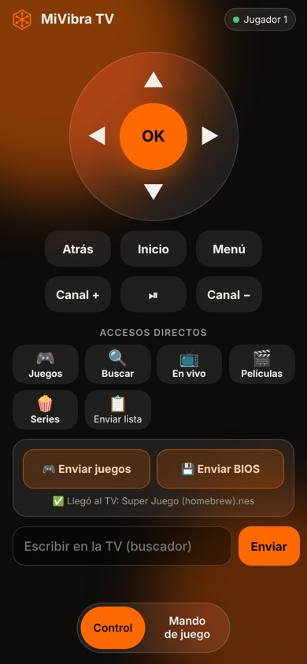

# MiVibra TV en televisores LG (webOS)

Funciona en LG Smart TV con webOS (3.0 en adelante, modelos 2016+). Se instala desde un PC; después **se actualiza sola** cada vez que abres la app con internet.

## Lo que necesitas
- El TV LG y un PC **en el mismo Wi-Fi**.
- Una cuenta gratuita de desarrollador LG: https://webostv.developer.lge.com (Sign in → crea la cuenta).
- El archivo **MiVibraTV-LG.ipk** de la última versión: https://github.com/simank19/mivibra-tv/releases/latest

## 1. Activar el modo desarrollador en el TV
1. En el TV abre **LG Content Store**, busca e instala la app **Developer Mode**.
2. Ábrela e inicia sesión con tu cuenta de desarrollador LG.
3. Activa **Dev Mode Status** (el TV se reinicia).
4. Vuelve a abrir **Developer Mode** y activa **Key Server**. Anota la **IP** del TV y la **Passphrase** (6 letras) que muestra.

> El modo desarrollador dura **50 horas**. Antes de que se acabe, abre la app Developer Mode y toca **Extend** (extender). Si se vence, el TV borra las apps instaladas así y toca volver a instalar MiVibra TV.

## 2. Instalar webOS Dev Manager en el PC
Es un programa gratuito con ventanas (no hace falta usar comandos):
https://github.com/webosbrew/dev-manager-desktop/releases/latest
(Windows: el `.msi`; Mac: el `.dmg`; Linux: el `.AppImage`).

## 3. Conectar el TV e instalar
1. Abre **webOS Dev Manager** → **Add device**.
2. Escribe un nombre, la **IP del TV**, deja el puerto `9922`, usuario `prisoner` y en contraseña la **Passphrase** del paso 1.
3. Ya conectado, entra a **Apps** → **Install** y elige **MiVibraTV-LG.ipk**.

Listo: **MiVibra TV** aparece en el menú de apps del TV.

### Con comandos (opcional)
Si prefieres la terminal (con `npm install -g @webos-tools/cli`):
```
ares-setup-device        (agrega el TV con su IP y la passphrase)
ares-install -d NOMBRE_DEL_TV MiVibraTV-LG.ipk
```

## Al abrirla por primera vez
- Entra con **"Entrar con el celular (código)"** y quedas con tu misma cuenta: listas, perfiles, favoritos, historial y avances se sincronizan solos con el celular, el TV Android y el PC.
- Las mejoras llegan solas: la app usa la versión más reciente publicada cada vez que se abre con internet.

## Control y juegos desde el celular

<p align="center"></p>

- **Control:** en la TV entra a *Ajustes › Mando con celular* y escanea el código QR con la cámara del celular. Se abre el control en el navegador (no hay que instalar nada) y funciona por internet.
- **Enviar juegos:** con el celular en el **mismo Wi-Fi** que la TV, en el control toca **Enviar juegos** (o **Enviar BIOS**) y elige los archivos. Van directo a la TV por tu Wi-Fi y aparecen en *Juegos*. Usa tus propias copias de seguridad o juegos libres; hasta unos 200 MB por juego.
- **Mando de juego:** al abrir un juego, el control del celular cambia solo a mando de juego (cada celular es un jugador). También se puede jugar con el control del TV: cruceta, OK = A, rojo = B, reproducir = START; **Atrás** abre el menú del juego (continuar, guardar y salir, reiniciar).
- **Consolas que funcionan:** NES, Super Nintendo, Game Boy / Color / Advance, Sega Genesis, Master System, Game Gear, Atari, PC Engine, Neo Geo Pocket, WonderSwan y arcade (Neo Geo necesita la BIOS neogeo.zip). PlayStation 1, N64 y DS pueden ir lentas según el TV. PSP, Dreamcast, GameCube y los ports (Doom, Quake) no.
- El emulador (EmulatorJS) se descarga solo la primera vez que juegas cada consola.

## Qué no tiene en LG
Descargas para ver sin internet, reproductor externo, juegos de Google Drive, las consolas pesadas (PSP, Dreamcast, GameCube) y los portales MAC (Stalker). Todo lo demás funciona igual.

## Problemas comunes
- **No conecta en Dev Manager** → revisa que Key Server esté activo y que la passphrase sea la que muestra el TV en ese momento.
- **La app desapareció** → se venció el modo desarrollador (50 horas sin extender): actívalo de nuevo e instala otra vez.
- **Un canal no abre** → la app prueba otras formas sola; si sigue, prueba otro enlace del mismo canal.
