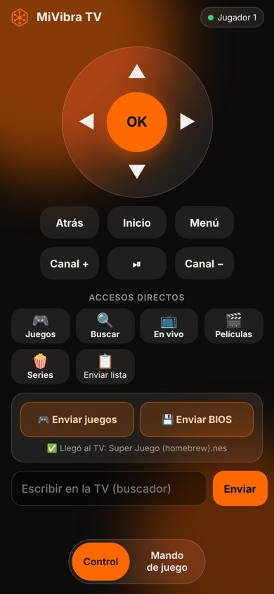

# MiVibra TV en televisores Samsung (Tizen)

Funciona en televisores Samsung Smart TV con Tizen (modelos 2017 en adelante). Se instala una sola vez desde un PC; después **se actualiza sola** cada vez que abres la app con internet.

## Lo que necesitas
- El TV Samsung y un PC (Windows, Mac o Linux) **en el mismo Wi-Fi**.
- Una cuenta Samsung (gratis).
- El archivo **MiVibraTV-Samsung.wgt** de la última versión: https://github.com/simank19/mivibra-tv/releases/latest

## 1. Activar el modo desarrollador en el TV
1. En el TV abre **Apps** (Aplicaciones).
2. Con el control, marca **1 2 3 4 5** (en algunos controles: botón 123 → teclado numérico).
3. Activa **Developer mode** (Modo desarrollador) y escribe la **IP de tu PC** (en Windows: `ipconfig`, línea "Dirección IPv4").
4. Apaga y prende el TV (desconéctalo 10 segundos si no aparece activo).
5. Anota la **IP del TV**: Configuración → General → Red → Estado de la red → Configuración de IP.

## 2. Instalar Tizen Studio en el PC
1. Descarga **Tizen Studio con IDE** (o "CLI") desde https://developer.tizen.org/development/tizen-studio/download
2. Al terminar se abre el **Package Manager**. En la pestaña **Extension SDK** instala:
   - **Samsung Certificate Extension**
   - **TV Extensions** (la versión más reciente)

## 3. Conectar el TV
1. Abre **Device Manager** (en Tizen Studio: Tools → Device Manager).
2. Toca **Remote Device Manager** → **+**, escribe un nombre y la **IP del TV**, puerto `26101`, y actívalo.
3. El TV debe aparecer en la lista como conectado.

## 4. Crear tu certificado Samsung (una sola vez)
1. Abre **Certificate Manager** (Tools → Certificate Manager) → **+**.
2. Elige **Samsung** → **TV** → ponle un nombre al perfil, por ejemplo `MiVibra`.
3. Crea el certificado de autor (nombre y contraseña) e **inicia sesión con tu cuenta Samsung** cuando lo pida.
4. En el certificado de distribuidor deja **Privilege: Public** y verifica que aparezca el **DUID de tu TV** (sale solo si el TV está conectado).
5. Termina. Ese perfil queda **activo**.

## 5. Firmar e instalar MiVibra TV
Abre una terminal en la carpeta donde está el `.wgt` (en Windows, la carpeta de Tizen Studio está en `C:\tizen-studio\tools\ide\bin` — agrégala al PATH o usa la ruta completa):

```
tizen package -t wgt -s MiVibra -- MiVibraTV-Samsung.wgt
sdb devices
tizen install -n MiVibraTV-Samsung.wgt -t NOMBRE_DEL_TV
```

`MiVibra` es el nombre del perfil del paso 4 y `NOMBRE_DEL_TV` es el que muestra `sdb devices`.

Listo: **MiVibra TV** aparece en las apps del TV.

## Al abrirla por primera vez
- Entra con **"Entrar con el celular (código)"**: escaneas el código con el celular y quedas con tu misma cuenta. Tus listas, perfiles, favoritos, historial y avances se sincronizan solos con el celular, el TV Android y el PC.
- Las mejoras nuevas llegan solas: la app usa la versión más reciente publicada cada vez que se abre con internet. Solo hay que reinstalar si cambia algo del propio TV (te avisaremos).

## Control y juegos desde el celular

<p align="center"></p>

- **Control:** en la TV entra a *Ajustes › Mando con celular* y escanea el código QR con la cámara del celular. Se abre el control en el navegador (no hay que instalar nada) y funciona por internet.
- **Enviar juegos:** con el celular en el **mismo Wi-Fi** que la TV, en el control toca **Enviar juegos** (o **Enviar BIOS**) y elige los archivos. Van directo a la TV por tu Wi-Fi y aparecen en *Juegos*. Usa tus propias copias de seguridad o juegos libres; hasta unos 200 MB por juego.
- **Mando de juego:** al abrir un juego, el control del celular cambia solo a mando de juego (cada celular es un jugador). También se puede jugar con el control del TV: cruceta, OK = A, rojo = B, reproducir = START; **Atrás** abre el menú del juego (continuar, guardar y salir, reiniciar).
- **Consolas que funcionan:** NES, Super Nintendo, Game Boy / Color / Advance, Sega Genesis, Master System, Game Gear, Atari, PC Engine, Neo Geo Pocket, WonderSwan y arcade (Neo Geo necesita la BIOS neogeo.zip). PlayStation 1, N64 y DS pueden ir lentas según el TV. PSP, Dreamcast, GameCube y los ports (Doom, Quake) no.
- El emulador (EmulatorJS) se descarga solo la primera vez que juegas cada consola.

## Qué no tiene en Samsung
Descargas para ver sin internet, reproductor externo, juegos de Google Drive, las consolas pesadas (PSP, Dreamcast, GameCube) y los portales MAC (Stalker). Todo lo demás funciona igual.

## Problemas comunes
- **"Install failed: certificate"** → el certificado no tiene el DUID de ese TV: vuelve a crearlo con el TV conectado.
- **El TV no aparece en Device Manager** → revisa que el modo desarrollador tenga la IP del PC y reinicia el TV.
- **Un canal no abre** → igual que en Android, la app prueba otras formas; si sigue, prueba otro enlace del mismo canal.
